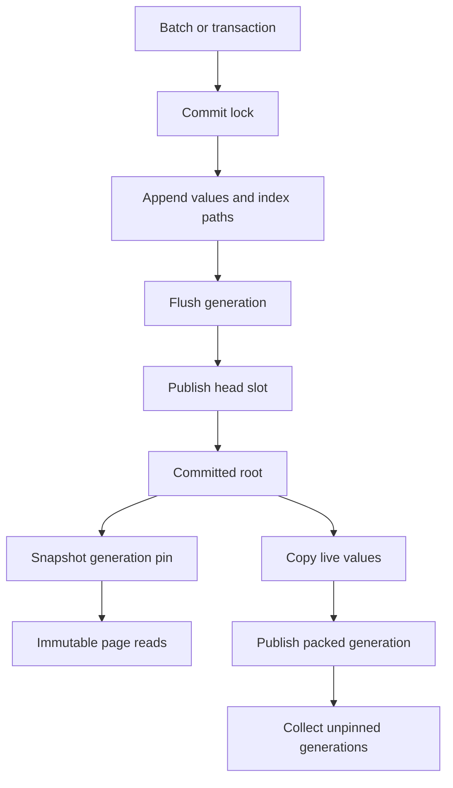

# Architecture

VERIFIED: DBSONL separates a portable transactional engine from byte storage and coordination. DSON owns serialization and frame CRC32C checks. Storage owns bounded writes and portable byte I/O; the native connection adds bounded positional reads of immutable committed data. DBSONL owns immutable indexing, commit ordering, snapshot lifetime and reclamation.

## Why this design

VERIFIED: A persistent B+tree avoids a database-sized RAM map without requiring a second database dependency. Fanout 32 trades modest page sizes for logarithmic tree navigation. Values are separate DSON frames; pages contain only keys, references and revisions. Rewriting a path rather than mutating it gives readers stable roots with no undo log. A batch coalesces edits in private dirty nodes and persists each final dirty page once, avoiding unobservable intermediate roots. A bounded LRU cache stores decoded pages, never application values. Open reads constant-size metadata and generation length, not every value.

VERIFIED: A two-slot manifest avoids relying on atomic rename, which Storage and OPFS do not expose uniformly. Each slot is a checksummed DSON frame in a 4096-byte region. The newest valid publication wins. Writers append after the published end, flush, then replace the older slot. A partial slot is ignored. An empty head whose generations are all empty is an interrupted create: only `create: true` initializes it, because no slot was published; invalid fields in a checksummed slot, a missing referenced generation or committed truncation fail closed. A failed publication reports `COMMIT_UNCERTAIN`; reread the revision before retrying. Successful publication increments the logical revision once per nonempty batch.

VERIFIED: These choices spend extra write bandwidth on index paths and two small metadata writes during compaction. They remove full replay and read-held writer exclusion. Benchmark evidence separates batch and per-record flush workloads rather than treating them as equivalent. A universal Pareto-optimality claim would require a defined workload distribution and objective function.

## Ownership and lock order

VERIFIED: The commit lock serializes head inspection and publication. A snapshot takes a shared generation pin while holding that lock, then releases the commit lock. Portable reads acquire short I/O locks because Storage 0.3.0 and OPFS grant exclusive handle ownership. Native reads use independent read-only descriptors: committed prefixes are immutable, writers truncate only unpublished tails, and the pin prevents removal. A native snapshot therefore reads concurrently with appends. The lifetime of a read session does not reserve the commit lock.

VERIFIED: Native locks are separate whole-file locks scoped to open descriptions/handles; they do not expire with a clock or heartbeat. A paused process cannot lose ownership to a second writer. The kernel releases ownership on process death. Web Locks release when their worker/context dies. Memory coordination is instance-local. Raw Storage writes and unrelated processes ignoring the protocol are outside the ownership contract.

VERIFIED: Acquisition order is commit lock, generation pin, I/O lock. Snapshot readers use their pin and, for portable adapters, short I/O locks without reacquiring the commit lock. A direct `get()` holds the commit lock until its bounded lookup finishes, which also excludes collection without a separate snapshot pin. Compaction pins both its source and candidate generation before releasing the commit lock. It writes only the candidate and reads the source in short operations. Publication compares the original publication number, so even another compaction causes a conflict. Exclusive compaction keeps the commit lock through the copy for guaranteed progress.

## Native read and write performance

VERIFIED: Every database handle owns a connection with at most two idle read descriptors and one idle commit-lock descriptor. In-flight reads retain their descriptors until completion. Local FIFO admission avoids polling for same-connection commit-lock contention; separate processes still acquire the same kernel lock. Commit-lock attempts use the nonblocking call of the shipped N-API binding of pinned `@lickle/lock` 0.0.1; pin and I/O locks use its nonblocking `tryLock` wrapper. No blocking lock acquisition or timeout-based ownership is introduced.

VERIFIED: `get()` reads the current head under the commit lock on every call. It can overlap this with a lookup through the previously parsed root. That candidate is accepted only if every head byte is unchanged; otherwise it is discarded and the current root is read. Both branches are drained before releasing the lock, including on errors. A per-handle 8 KiB parse cache avoids repeated DSON decoding, not fresh I/O. Aligned comparisons use 32-bit words; measured manual unrolling was not retained because it regressed Node.

VERIFIED: Known-length record references are checked against both committed end and the record budget before allocation. Native reads then fetch and checksum the complete frame. Values are decoded anew for every point lookup. Each native scan or compaction keeps one read-ahead window of at most 64 KiB within its pinned prefix. Large values bypass that window. The writer buffers at most 64 KiB, drains it before the file flush, and only then publishes the head, so buffering never reorders data ahead of publication.

VERIFIED: Native read descriptors do not participate in Storage's exclusive handle registry. This is limited to regular, read-only files and the DBSONL immutability protocol; mutations still use Storage and its I/O lock. `collect()` unlinks unpinned files and closes its connection's idle reader for each removed generation. Another idle process may still hold an unlinked descriptor until eviction or database close; OS disk-space release can therefore lag namespace removal. Closing all idle database handles releases those resources. Replacing live head or generation inodes outside this protocol is unsupported.

## Reclamation and crashes

VERIFIED: Compaction copies live values with a streaming bulk builder that retains at most 32 references per level. It writes both head slots to the new generation before returning. Collection refreshes the alternate slot to the selected head, then tries exclusive pins on obsolete generations. Busy generations remain. Candidate pins protect a concurrent compactor from collection. Abandoned candidates from killed processes become collectible.

VERIFIED: Native lock files for reclaimed generations are removed while the commit lock excludes new pin creation. The current generation and fixed database locks remain. This prevents an inode replacement race between old and new lock owners. Cleanup requires exclusive ownership; there are no age-based stale-lock guesses.

VERIFIED: Data written after the published end is private. A later writer truncates only that unpublished tail. A committed frame with a bad checksum fails when read; `verify()` walks all reachable values and index pages, validates ordering, counts and revisions. Neither compaction nor open repairs published corruption. Old snapshots delay reclamation intentionally, preserving their data.

## Transactions, memory and lifecycle

VERIFIED: Batch values are encoded before admission returns, preventing caller mutation during queued work. Both per-transaction and aggregate pending-byte budgets are enforced. A transaction callback reads from one snapshot plus a bounded staged overlay. The final database revision must still equal its snapshot revision, including read-only transactions and range scans. This conservative validation provides serializability but can reject transactions touching disjoint keys. Automatic retries are omitted because callbacks may have external effects.

VERIFIED: Closing a snapshot rejects new reads, drains admitted reads and releases its pin. Paused iterators do not prevent closure. Closing a database stops admission, drains operations, closes its snapshots and discards its cache. Cancellation is cooperative during waiting and copying. After publication starts, completion is success or an uncertain commit error rather than an ordinary cancellation.

## Operations, security and privacy

VERIFIED: The trusted storage root is application-owned. Native byte and lock files reject symlink traversal where supported; database names are lowercase identifiers. Bounds and backward-only child references reject malformed addresses and disk cycles. CRC32C detects damage, not forgery. DSON values may be cyclic and contain binary data. Applications needing encryption or authentication must provide those policies separately.

VERIFIED: There is no network service or background maintenance. Applications schedule `compact()` and `collect()` and close snapshots promptly. Maintenance needs enough disk space for the live copy. No telemetry or application-value logging occurs. Tests use temporary databases and real processes. Source, tests, examples and tooling each document their own responsibilities in ARCH.md.
