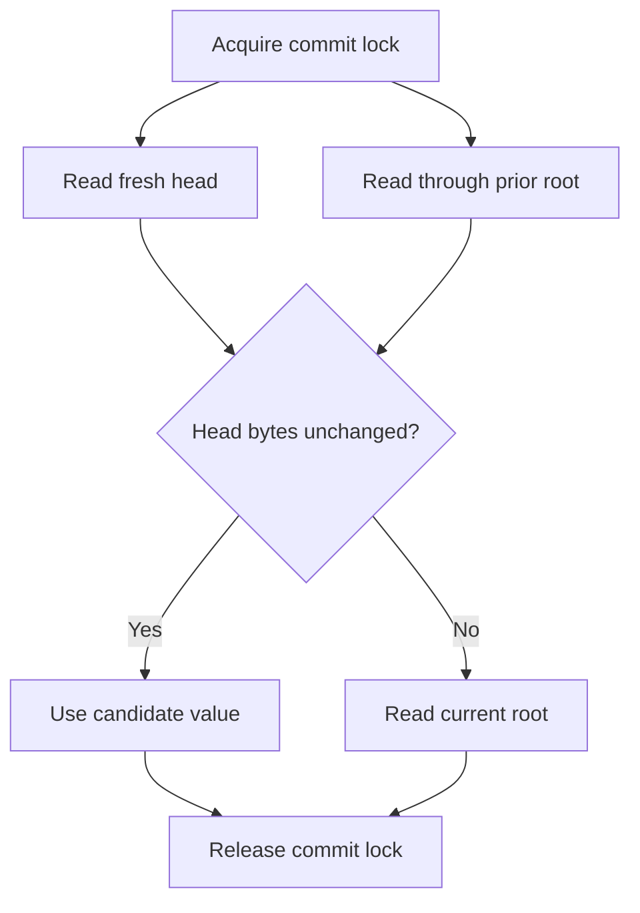

# Performance evidence

VERIFIED: Every table compares the shipped v0.2.0 package with a later build under the same format, transactional API, durability barriers, values and assertions. The Linux tables and the macOS run measured 0.3.0 builds; the "v0.3" columns name that build. Version 0.4.0 removed the legacy entries and reads the writer's index pages with one known-length read instead of a header read plus a payload read. The measured read paths are the same code.

## Default native asynchronous I/O

VERIFIED: Times below are medians of seven measured rounds after two complete warmup rounds, in milliseconds per 1000 operations or rows. Batch means one atomic commit of 1000 mutations, including flushes. Reopen is one indexed open, not 1000 opens. Raw samples, measured build SHA-256 hashes, exact runtime versions and host metadata are in `validation/bench.json` in the source ZIP.

| Runtime | Workload | v0.2 ms | v0.3 ms | Speedup |
| --- | --- | ---: | ---: | ---: |
| Node | Fresh-root get | 1047.47 | 65.36 | 16.03x |
| Node | Pinned snapshot get | 314.26 | 35.76 | 8.79x |
| Node | Snapshot scan | 311.30 | 14.94 | 20.83x |
| Node | Atomic batch | 53.18 | 25.18 | 2.11x |
| Node | Compaction | 370.27 | 32.40 | 11.43x |
| Node | Indexed reopen | 0.95 | 0.77 | 1.24x |
| Bun | Fresh-root get | 1119.24 | 87.27 | 12.83x |
| Bun | Pinned snapshot get | 378.80 | 43.04 | 8.80x |
| Bun | Snapshot scan | 358.17 | 21.72 | 16.49x |
| Bun | Atomic batch | 68.30 | 39.16 | 1.74x |
| Bun | Compaction | 405.82 | 45.94 | 8.83x |
| Bun | Indexed reopen | 0.81 | 0.78 | 1.04x |

## Worker/CLI synchronous I/O and memory

VERIFIED: Synchronous I/O is opt-in through the `createFileBackend(root, {io: "sync"})` option. It blocks its calling thread, including during fsync. Use a worker or CLI when choosing this mode. The asynchronous mode above remains the default. Memory results show the portable path separately.

| Runtime | Mode | v0.2 get ms | v0.3 get ms |
| --- | --- | ---: | ---: |
| Node | sync | 872.49 | 23.76 |
| Node | memory | 45.05 | 31.18 |
| Bun | sync | 952.36 | 45.99 |
| Bun | memory | 82.25 | 56.39 |

VERIFIED: Not every microbenchmark necessarily improves. The raw report includes memory snapshots, scans, batches and reopen costs as well as the native gains. Small sub-millisecond reopen differences and memory-path variation are not hidden by averaging them into a single score.

## Why the read path changed

VERIFIED: Source tracing, instrumented real reads and a Node CPU profile located repeated file open/close operations, lock dispatch, metadata decoding and small reads on the original path. The initial native baseline repeated the slowdown: approximately one second for 1000 fresh-root lookups. A syscall trace could not run because ptrace is disabled in this environment; no syscall-count claim is made.



VERIFIED: Every direct get still reads the current manifest under the cross-process commit lock. Its prior-root candidate is accepted only if all head bytes match. A changed head triggers a fresh lookup; even speculative errors from a generation collected by another process are ignored only when the head changed. Both reads drain before lock release. A stale metadata cache therefore cannot return an older committed value.

VERIFIED: Descriptor reuse removes repeated opens and closes. A local FIFO avoids self-contention polling. The pinned native binding exposes a nonblocking commit-lock attempt without a thread-pool dispatch; contended locks still wait asynchronously. Native read callbacks avoid FileHandle promise bookkeeping while explicit in-flight ownership protects descriptor lifetime. Cached index pages return directly; cache misses remain asynchronous. Known, validated record lengths allow one frame read, allocation and checksum/decode path rather than a header read followed by a payload read. This also applies to portable backends.

VERIFIED: The manifest cache stores parsed metadata only. Every get compares newly read bytes; point values are freshly read and decoded, including after warming. Native scans and compaction have one bounded 64 KiB read-ahead window. A changed-head point read may temporarily hold both its discarded candidate and the current decoded value. The writer coalesces small frames into at most 64 KiB before the existing file-flush/head-publication barrier. None of these changes removes a flush, CRC check, transaction conflict check or snapshot pin.

## JIT and loop-unrolling experiment

VERIFIED: `scripts/microbench.ts` checks equal, unequal, empty, short and unaligned inputs, consumes every result, reverses kernel order and records seven rounds after two warmups. The table measures 20000 comparisons of an 8192-byte manifest in milliseconds.

| Runtime | Byte loop | 32-bit word loop | Four-way unrolled words |
| --- | ---: | ---: | ---: |
| Node | 164.88 | 42.51 | 44.69 |
| Bun | 92.55 | 31.58 | 34.38 |

VERIFIED: The shared implementation uses the word loop with a byte fallback for unaligned buffers or lengths. Four-way unrolling did not consistently beat it across both engines and runs. The results support this specific choice, not a claim that all JITs or workloads are optimally compiled.

## macOS arm64 run

VERIFIED: One run of `make bench` on an Apple M5 Max (18 logical CPUs) under macOS 25.6.0, on APFS, with Node 24.22.1 and Bun 1.4.3. It used the same protocol and bundled v0.2 tarball as the Linux tables above. The machine was not idle: the load average was about 5. Raw samples are in `validation/bench-macos-arm64.json`.

| Runtime | Workload | v0.2 ms | v0.3 ms | Speedup |
| --- | --- | ---: | ---: | ---: |
| Node | Fresh-root get | 670.84 | 36.53 | 18.37x |
| Node | Pinned snapshot get | 216.89 | 15.97 | 13.58x |
| Node | Snapshot scan | 187.84 | 5.65 | 33.27x |
| Node | Atomic batch | 35.54 | 21.41 | 1.66x |
| Node | Compaction | 264.08 | 25.56 | 10.33x |
| Node | Indexed reopen | 0.79 | 0.68 | 1.18x |
| Bun | Fresh-root get | 595.69 | 34.35 | 17.34x |
| Bun | Pinned snapshot get | 187.97 | 19.07 | 9.86x |
| Bun | Snapshot scan | 180.02 | 8.67 | 20.77x |
| Bun | Atomic batch | 30.29 | 14.68 | 2.06x |
| Bun | Compaction | 219.94 | 18.20 | 12.08x |
| Bun | Indexed reopen | 0.53 | 0.36 | 1.48x |

VERIFIED: The ratios against v0.2 are close to the Linux ones, so the read-path gains do not depend on one platform. Absolute times differ from Linux because the hardware differs; this is not a platform ranking. In synchronous mode, v0.3 get takes 14.30 ms on Node and 26.75 ms on Bun. For the memory backend, the v0.3 speedups are 1.1x to 1.9x. Indexed reopen in memory stays within 0.01 ms in both runtimes, which is noise at this resolution.

## Reproduction and scope

```sh
make setup
make verify
make bench        # 1000 records, both runtimes, async/sync/memory, 7 rounds
make bench-scale  # 10000 records, both runtimes, native async, 3 rounds
```

VERIFIED: The checksum-pinned v0.2 tarball is bundled under `vendor/`. Each benchmark child imports one built package, uses a new temporary database, checks every returned value and scan count, verifies the database, and closes it. Version order is reversed between runtimes. Reopen follows close; the OS filesystem cache is warm. The benchmark does not silently select a subset of rounds.

VERIFIED: The recorded environment is Linux x64 on a shared AMD EPYC host with an overlay filesystem, Node 24.22.1 and Bun 1.4.3. These results do not establish cold-device latency, sustained mixed-workload p99, Windows performance, or a universal optimum; the macOS run above is a single run. CPU contention and runtime tiering cause run-to-run variation.

VERIFIED: Native handle caching retains at most two idle read descriptors and one idle commit descriptor per open database handle. GC unlinks obsolete files; another process retaining an idle descriptor can delay physical disk-space release until eviction or close. Explicit snapshots deliberately retain their generations. Applications should close idle handles, and must not replace live file inodes outside the DBSONL protocol.

VERIFIED: Correctness tests use real storage, file permissions, truncated/corrupt images, actual kernel locks, process termination and browser workers. Mixed v0.2/v0.3 Node/Bun writers exercise format and lock interoperability. These checks cover process failure; they do not certify power-loss behavior.

## 10000-record scaling check

VERIFIED: Native asynchronous I/O, two complete warmups and three measured rounds. Times are milliseconds per 10000 lookups. Raw measurements and the remaining workloads are in `validation/bench-scale.json`.

| Runtime | v0.2 get ms | v0.3 get ms | Speedup |
| --- | ---: | ---: | ---: |
| Node | 10170.90 | 609.91 | 16.68x |
| Bun | 10569.36 | 930.02 | 11.36x |
