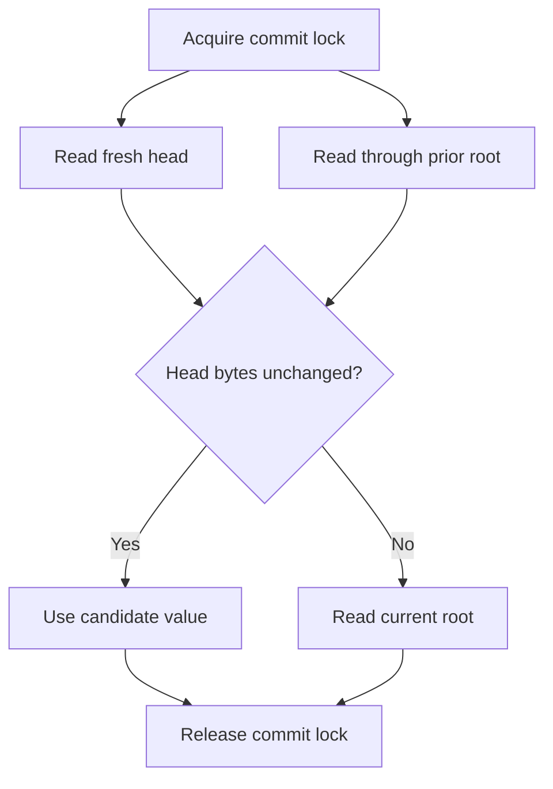

# Performance evidence

VERIFIED: Every table compares builds under the same format, transactional API, durability barriers, values and assertions. The macOS arm64 tables measure v0.2.0, v0.3.0 and v0.4.0 in the same runs. The Linux x64 tables come from an earlier run that measured v0.2.0 and a 0.3.0 build only; no Linux host was available for 0.4.0. The vendored 0.3.0 tarball is the build those Linux tables measured: its `dist` hashes match the recorded artifacts. The Redis section compares the current source with another store instead, under the pairings it states.

## macOS arm64: v0.2, v0.3 and v0.4

VERIFIED: Three consecutive runs of `make bench` under the pinned toolchain (`mise exec`) on an Apple M5 Max (18 logical CPUs), macOS 25.6.0, APFS, Node 24.22.1 (V8) and Bun 1.4.3 (JavaScriptCore), on 2026-11-15. The machine was busy, with a load average between 4.6 and 8.3. Each run takes the median of seven rounds after two warmups; the tables show the median of the three runs. Times are milliseconds per 1000 operations or rows; batch, compaction and reopen are per workload. All three raw reports are in `validation/bench-macos-arm64.json`.

| Runtime | Workload | v0.2 ms | v0.3 ms | v0.4 ms | v0.4 vs v0.2 |
| --- | --- | ---: | ---: | ---: | ---: |
| Node | Fresh-root get | 445.39 | 30.07 | 31.14 | 14.31x |
| Node | Pinned snapshot get | 132.79 | 13.53 | 12.98 | 10.23x |
| Node | Snapshot scan | 129.26 | 4.99 | 5.55 | 23.29x |
| Node | Atomic batch | 31.60 | 19.53 | 18.68 | 1.69x |
| Node | Compaction | 177.95 | 24.76 | 24.65 | 7.22x |
| Node | Indexed reopen | 0.48 | 0.47 | 0.52 | 0.93x |
| Bun | Fresh-root get | 514.84 | 39.91 | 41.10 | 12.53x |
| Bun | Pinned snapshot get | 155.19 | 15.89 | 17.35 | 8.94x |
| Bun | Snapshot scan | 155.67 | 7.58 | 9.37 | 16.62x |
| Bun | Atomic batch | 26.97 | 14.05 | 12.84 | 2.10x |
| Bun | Compaction | 180.52 | 18.97 | 19.37 | 9.32x |
| Bun | Indexed reopen | 0.38 | 0.34 | 0.31 | 1.24x |

| Runtime | Mode | v0.2 get ms | v0.3 get ms | v0.4 get ms |
| --- | --- | ---: | ---: | ---: |
| Node | sync | 398.20 | 13.08 | 13.85 |
| Node | memory | 21.66 | 12.09 | 11.21 |
| Bun | sync | 436.05 | 24.07 | 28.45 |
| Bun | memory | 27.86 | 21.15 | 23.50 |

VERIFIED: On Node, v0.3 and v0.4 trade places from run to run with no consistent direction. On Bun, v0.4 was slower than v0.3 in all three runs for snapshot reads and scans on memory storage (20% to 26%), scans on native synchronous I/O (14% to 34%) and scans on native asynchronous I/O (12% to 28%). Both builds issue the same Storage reads.

UNKNOWN: Why Bun runs these 0.4.0 read paths slower. Decoding moved into a shared `decodeRef` helper and the bundle layout changed when the legacy entries were removed; a Bun CPU profile of the memory snapshot-scan workload on both builds would locate the difference.

VERIFIED: The 10000-record check is one run of `make bench-scale` in the same session, native asynchronous I/O, two warmups and three measured rounds, in milliseconds per 10000 lookups. Raw measurements are in `validation/bench-scale-macos-arm64.json`.

| Runtime | v0.2 get ms | v0.3 get ms | v0.4 get ms | v0.4 vs v0.2 |
| --- | ---: | ---: | ---: | ---: |
| Node | 4510.49 | 308.34 | 335.31 | 13.45x |
| Bun | 5377.49 | 465.28 | 357.13 | 15.06x |

## Compared with Redis on macOS arm64

VERIFIED: Three consecutive runs of `mise exec -- make bench-redis` on 2026-11-16, on the host above, with Node 24.22.1, Bun 1.4.3, Redis 8.10.3 from the mise conda build (libc malloc) and the node-redis 5.12.1 client over loopback TCP. They measured the 0.5.0 source, on defuss-dson 1.4.0 and defuss-storage 0.3.1, before its version number changed, so the raw reports name 0.4.0. Other work kept the machine busy: the 1-minute load average, sampled when each worker started and ended, ranged from 5.5 to 10.9. Each run takes two warmups and seven measured rounds over 1000 records of about 130 JSON bytes, the engine that runs first alternates per round, and each engine's turn starts after a full garbage collection. The table shows the median of the three per-run medians in milliseconds per 1000 operations; a batch is one commit of 1000 writes, and the contended figure is the wall time until four writers have committed 1000 transfers together. All three raw reports are in `validation/bench-redis-macos-arm64.json`.

VERIFIED: Durable pairs the native asynchronous file backend with Redis `appendonly yes` and `appendfsync always`. Volatile pairs the memory backend with Redis `appendonly no` and `save ""`. A transfer reads two keys and writes both: Redis sends `WATCH`, two `GET`s and `MULTI`, `SET`, `SET`, `EXEC`; defuss-dbsonl runs `transaction()`. Redis stores JSON strings and defuss-dbsonl encodes DSON. Each contending Redis writer has its own connection, because `WATCH` belongs to a connection; the four defuss-dbsonl writers share one database handle. Both retry on a conflict, and both keep the sum of all scores unchanged in every round.

VERIFIED: The last column repeats the ratio from three runs of the 0.4.0 engine on defuss-storage 0.3.0, with the same script before it collected garbage between turns, at a load average of 10 to 23; their reports are in `validation/bench-redis-macos-arm64-baseline.json`. Redis itself ran at different speeds under the two loads, so only the ratios compare, not the milliseconds. A ratio below 1 means defuss-dbsonl took less time.

| Runtime | Mode | Workload | dbsonl ms | Redis ms | dbsonl / Redis | 0.4.0 ratio |
| --- | --- | --- | ---: | ---: | ---: | ---: |
| Node | durable | Point read | 27.30 | 47.25 | 0.58 | 0.90 |
| Node | durable | Atomic batch | 13.44 | 6.55 | 2.05 | 3.86 |
| Node | durable | Transaction | 7572.99 | 3823.43 | 1.98 | 2.95 |
| Node | durable | Contended transaction | 1945.98 | 2994.13 | 0.65 | 4.03 |
| Node | volatile | Point read | 11.68 | 42.18 | 0.28 | 0.35 |
| Node | volatile | Atomic batch | 5.37 | 2.46 | 2.18 | 5.77 |
| Node | volatile | Transaction | 82.15 | 155.37 | 0.53 | 1.96 |
| Node | volatile | Contended transaction | 63.33 | 76.39 | 0.83 | 6.39 |
| Bun | durable | Point read | 32.45 | 39.24 | 0.83 | 1.15 |
| Bun | durable | Atomic batch | 2.70 | 5.34 | 0.50 | 2.65 |
| Bun | durable | Transaction | 427.50 | 3780.74 | 0.11 | 0.72 |
| Bun | durable | Contended transaction | 165.85 | 3018.68 | 0.05 | 0.90 |
| Bun | volatile | Point read | 20.05 | 44.14 | 0.45 | 0.35 |
| Bun | volatile | Atomic batch | 2.25 | 1.39 | 1.61 | 2.61 |
| Bun | volatile | Transaction | 93.13 | 206.50 | 0.45 | 2.48 |
| Bun | volatile | Contended transaction | 68.64 | 84.00 | 0.82 | 8.98 |

VERIFIED: defuss-dbsonl took less time than Redis in 12 of the 16 pairings, against 4 for 0.4.0. No contending writer of either engine retried in these runs; 0.4.0 retried 1850 to 2890 times per 1000 commits.

VERIFIED: Collecting garbage before each turn changed the batch figures most. Without it, Redis batches under Bun took about 1 ms in rounds where Redis went first and 3.5 to 8 ms in rounds where it ran right after defuss-dbsonl, and defuss-dbsonl's Node batches took longer in rounds where they went second, because each engine's garbage was collected inside the other's timed work. The previous round, without collection, put Bun's memory batch at 0.47 of Redis's time; with collection Redis's batch stays near 1.4 ms and the ratio is 1.61.

VERIFIED: Same-session probes attribute the gains since that round. defuss-dson 1.4.0 instead of a local plain-data encoder took 5% to 18% off point reads and 23% to 27% off Bun memory batches. Commit groups that wait for in-flight transactions (ARCH.md) took four contending durable Node writers from 4.4 to 2.1 ms per commit; they had alternated between groups of one and three. The index-page writer and the second-chance page cache took four contending memory writers from 59 to 49 µs per commit under Node.

VERIFIED: The durable Node batch and transaction lose because of flushes. A durable defuss-dbsonl commit flushes twice: the generation file, then the head slot in `publish()` in `src/core/io.ts`. Redis with `appendfsync always` flushes its log once before it answers `EXEC`. In a one-off probe of 300 writes of 4 KiB through the native Storage adapter, each followed by `flush()`, a write and its flush averaged 3.16 ms under Node and 0.044 ms under Bun on this host, so two Node flushes alone take longer than a Redis transaction. Four contending writers share both flushes in one group, and that pairing takes 0.65 of Redis's time.

VERIFIED: The memory batches lose to encoding. In a CPU profile of a Node memory batch, encoding the 1000 values as DSON frames, with their CRC32C, took about 46% of the time and the index pages about 8%; Redis's client serializes with the runtime's built-in `JSON.stringify`.

VERIFIED: Rejected in these probes: splitting pages at 16 or 8 entries instead of 32 left contended memory commits within noise and made memory batches 10% to 30% slower; deduplicating objects by identity in the page writer cost a leaf 1.5 to 2 µs of its gain; inserting cached pages unmarked was slightly slower than marking them. An earlier commit delay that waited before setting the head new snapshots pin measured 3.90 to 3.92 ms per contended Node commit against 3.62 to 3.81 ms without it. Cutting small frames from shared slabs left batch times within run-to-run noise.

## Linux x64: v0.2 and v0.3

VERIFIED: Times below are medians of seven measured rounds after two complete warmup rounds, in milliseconds per 1000 operations or rows. Batch means one atomic commit of 1000 mutations, including flushes. Reopen is one indexed open, not 1000 opens. Raw samples, measured build SHA-256 hashes, exact runtime versions and host metadata are in `validation/bench.json` in the source ZIP.

| Runtime | Workload | v0.2 ms | v0.3 ms | Speedup |
| --- | --- | ---: | ---: | ---: |
| Node | Fresh-root get | 1047.47 | 65.36 | 16.03x |
| Node | Pinned snapshot get | 314.26 | 35.76 | 8.79x |
| Node | Snapshot scan | 311.30 | 14.94 | 20.83x |
| Node | Atomic batch | 53.18 | 25.18 | 2.11x |
| Node | Compaction | 370.27 | 32.40 | 11.43x |
| Node | Indexed reopen | 0.95 | 0.77 | 1.24x |
| Bun | Fresh-root get | 1119.24 | 87.27 | 12.83x |
| Bun | Pinned snapshot get | 378.80 | 43.04 | 8.80x |
| Bun | Snapshot scan | 358.17 | 21.72 | 16.49x |
| Bun | Atomic batch | 68.30 | 39.16 | 1.74x |
| Bun | Compaction | 405.82 | 45.94 | 8.83x |
| Bun | Indexed reopen | 0.81 | 0.78 | 1.04x |

### Worker/CLI synchronous I/O and memory

VERIFIED: Synchronous I/O is opt-in through the `createFileBackend(root, {io: "sync"})` option. It blocks its calling thread, including during fsync. Use a worker or CLI when choosing this mode. The asynchronous mode above remains the default. Memory results show the portable path separately.

| Runtime | Mode | v0.2 get ms | v0.3 get ms |
| --- | --- | ---: | ---: |
| Node | sync | 872.49 | 23.76 |
| Node | memory | 45.05 | 31.18 |
| Bun | sync | 952.36 | 45.99 |
| Bun | memory | 82.25 | 56.39 |

VERIFIED: Not every microbenchmark necessarily improves. The raw report includes memory snapshots, scans, batches and reopen costs as well as the native gains. Small sub-millisecond reopen differences and memory-path variation are not hidden by averaging them into a single score.

### 10000-record scaling check

VERIFIED: Native asynchronous I/O, two complete warmups and three measured rounds. Times are milliseconds per 10000 lookups. Raw measurements and the remaining workloads are in `validation/bench-scale.json`.

| Runtime | v0.2 get ms | v0.3 get ms | Speedup |
| --- | ---: | ---: | ---: |
| Node | 10170.90 | 609.91 | 16.68x |
| Bun | 10569.36 | 930.02 | 11.36x |

## Why the read path changed

VERIFIED: Source tracing, instrumented real reads and a Node CPU profile located repeated file open/close operations, lock dispatch, metadata decoding and small reads on the original path. The initial native baseline repeated the slowdown: approximately one second for 1000 fresh-root lookups. A syscall trace could not run because ptrace is disabled in this environment; no syscall-count claim is made.



VERIFIED: Every direct get still reads the current manifest under the cross-process commit lock. Its prior-root candidate is accepted only if all head bytes match. A changed head triggers a fresh lookup; even speculative errors from a generation collected by another process are ignored only when the head changed. Both reads drain before lock release. A stale metadata cache therefore cannot return an older committed value.

VERIFIED: Descriptor reuse removes repeated opens and closes. A local FIFO avoids self-contention polling. The pinned native binding exposes a nonblocking commit-lock attempt without a thread-pool dispatch; contended locks still wait asynchronously. Native read callbacks avoid FileHandle promise bookkeeping while explicit in-flight ownership protects descriptor lifetime. Cached index pages return directly; cache misses remain asynchronous. Known, validated record lengths allow one frame read, allocation and checksum/decode path rather than a header read followed by a payload read. This also applies to portable backends.

VERIFIED: The manifest cache stores parsed metadata only. Every get compares newly read bytes; point values are freshly read and decoded, including after warming. Native scans and compaction have one bounded 64 KiB read-ahead window. A changed-head point read may temporarily hold both its discarded candidate and the current decoded value. The writer coalesces small frames into at most 64 KiB before the existing file-flush/head-publication barrier. None of these changes removes a flush, CRC check, transaction conflict check or snapshot pin.

## JIT and loop-unrolling experiment

VERIFIED: `scripts/microbench.ts` checks equal, unequal, empty, short and unaligned inputs, consumes every result, reverses kernel order and records seven rounds after two warmups. The table measures 20000 comparisons of an 8192-byte manifest in milliseconds.

| Runtime | Byte loop | 32-bit word loop | Four-way unrolled words |
| --- | ---: | ---: | ---: |
| Node | 164.88 | 42.51 | 44.69 |
| Bun | 92.55 | 31.58 | 34.38 |

VERIFIED: The shared implementation uses the word loop with a byte fallback for unaligned buffers or lengths. Four-way unrolling did not consistently beat it across both engines and runs. The results support this specific choice, not a claim that all JITs or workloads are optimally compiled.

## Reproduction and scope

```sh
make setup
make verify
make bench        # 1000 records, both runtimes, async/sync/memory, 7 rounds
make bench-scale  # 10000 records, both runtimes, native async, 3 rounds
```

VERIFIED: The checksum-pinned v0.2.0 and v0.3.0 tarballs are bundled under `vendor/`. Each benchmark child imports one built package, uses a new temporary database, checks every returned value and scan count, verifies the database, and closes it. Version order is reversed between runtimes. Reopen follows close; the OS filesystem cache is warm. The benchmark does not silently select a subset of rounds.

VERIFIED: The Linux environment is a shared AMD EPYC host with an overlay filesystem, Node 24.22.1 and Bun 1.4.3. Neither host establishes cold-device latency, sustained mixed-workload p99, Windows performance, or a universal optimum. CPU contention and runtime tiering cause run-to-run variation.

VERIFIED: Native handle caching retains at most two idle read descriptors and one idle commit descriptor per open database handle. GC unlinks obsolete files; another process retaining an idle descriptor can delay physical disk-space release until eviction or close. Explicit snapshots deliberately retain their generations. Applications should close idle handles, and must not replace live file inodes outside the DBSONL protocol.

VERIFIED: Correctness tests use real storage, file permissions, truncated/corrupt images, actual kernel locks, process termination and browser workers. Mixed v0.2.0 and current Node/Bun writers exercise format and lock interoperability. These checks cover process failure; they do not certify power-loss behavior.
